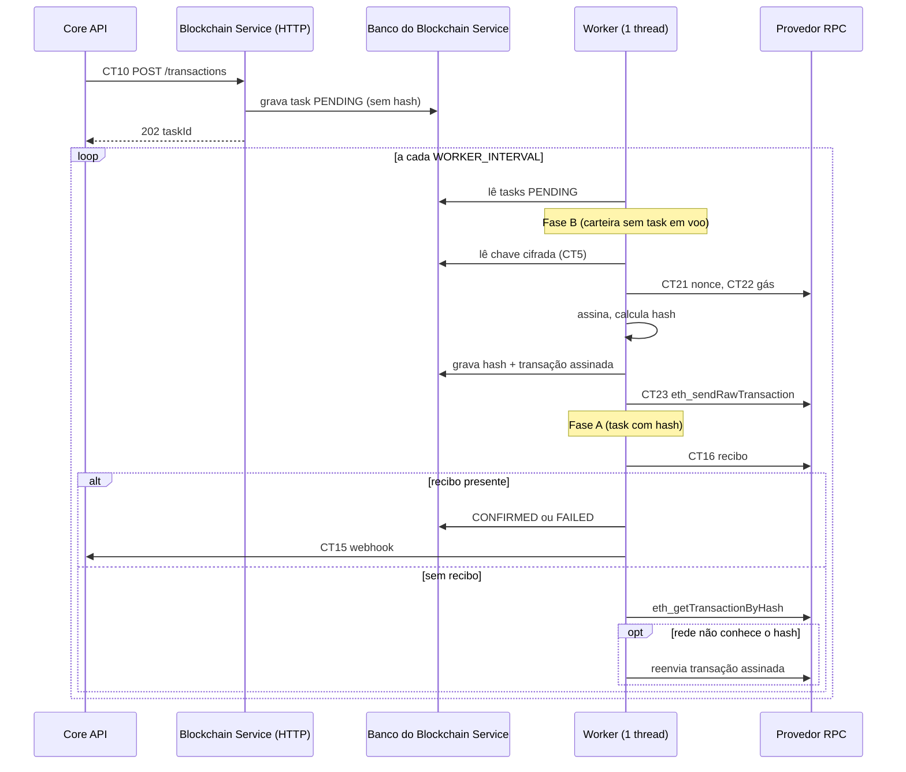

# Desenho do Blockchain Service (Container 3)
 
Rascunho para validação da equipe, em 07/11/2026 (estrutura em camadas incluída no mesmo dia). Fonte dos contratos: `especificacao-entrega2.md`.
 
Legenda usada em todo o documento:
- **[Contrato]**: já definido na Especificação (CT, P). Não muda sem emendar o contrato.
- **[Sugestão]**: proposta deste documento. Precisa de aval do grupo.
- **[Aberto]**: decisão ainda não tomada.
---
 
## 1. Papel e limites
 
O Blockchain Service é o único módulo que fala com a Ethereum. Ele:
 
1. Gera carteiras e guarda a chave privada cifrada. [Contrato: CT4, CT5, P7]
2. Consulta saldo no Provedor RPC. [Contrato: CT7, CT8]
3. Aceita pedidos de envio, cria uma task `PENDING` e responde 202. [Contrato: CT10, CT11]
4. Em segundo plano, assina e envia a transação, acompanha o recibo e avisa o Core API. [Contrato: CT21, CT22, CT23, CT16, CT15]
5. Responde ao Core API sobre o estado de uma task. [Contrato: CT14]
6. Retoma tasks `PENDING` depois de reinício. [Contrato: E9]
Ele **não**: conhece usuários, e-mails ou senhas; é chamado pelo Frontend; guarda histórico por usuário. Quem chama é só o Core API, sempre com `X-Service-Key` (P2).
 
Premissa de implantação [Sugestão]: **uma única instância** do container. O desenho de fila em banco (seção 7) depende disso. Para o projeto acadêmico, é a escolha mais simples e suficiente.
 
## 2. Tecnologias
 
| Item | Escolha | Origem |
|---|---|---|
| Linguagem | Java. Sugestão: 21 LTS, a confirmar com o que a equipe já usa | [Contrato] Java; versão [Sugestão] |
| HTTP | Javalin | [Contrato] |
| Cliente Ethereum | Web3j (módulo `core`) | [Contrato] |
| Banco | MySQL | [Contrato] (Especificação, Banco do Blockchain Service) |
| Acesso ao banco | Hibernate, a mesma stack do Core API | [Sugestão] (a Proposta deixou em aberto "Hibernate + MySQL ou algo mais simples") |
| JSON | Jackson (já vem com o Javalin) | [Sugestão] |
| Cifragem | `javax.crypto` (AES-GCM), sem biblioteca extra | [Sugestão] |
| Cliente HTTP do webhook | `java.net.http.HttpClient` do JDK | [Sugestão] |
| Log | SLF4J + Logback | [Sugestão] |
| Testes | JUnit 5 | [Sugestão] |
| Build | Maven ou Gradle: o que o repositório já usar | [Aberto] |
| Organização do código | Camadas controller, service, repository, model (seção 4) | [Sugestão] |
| Injeção de dependência | Nenhuma: montagem manual no `Main`; services e repositories são classes concretas, sem interface | [Sugestão] |
 
Justificativa de não usar Spring, Guice ou Flyway: o serviço tem 4 endpoints e 2 tabelas. Cada biblioteca extra é algo a mais para explicar à banca sem ganho real.
 
Versões exatas de Web3j, Javalin e Hibernate: fixar no `pom.xml`/`build.gradle` na criação do projeto, na última versão estável compatível com a versão de Java escolhida.
 
## 3. Infraestrutura
 
### 3.1 Containers
 
| Serviço no compose | Imagem | Observação |
|---|---|---|
| `blockchain-service` | build do repositório `-blockchain` | Dockerfile multi-stage (build com JDK, execução com JRE), usuário não root |
| `blockchain-db` | MySQL 8.x, tag fixa | Volume nomeado para os dados. Porta **não** publicada no host |
 
Regras [Contrato: H01.2]: o serviço só sobe depois do banco ficar saudável (`depends_on` com `condition: service_healthy`, healthcheck do MySQL com `mysqladmin ping`). Segredos em `.env` fora do git, com `.env.example` versionado.
 
Portas [Sugestão]: Core API 8080, Blockchain Service 8081, External Data Service 8082. Em desenvolvimento, publicar o 8081 só no loopback (`127.0.0.1:8081:8081`) para testar com `curl`. Na versão final, o Blockchain Service fica visível apenas na rede interna do compose.
 
### 3.2 Variáveis de ambiente
 
| Variável | Para quê | Exemplo |
|---|---|---|
| `SERVER_PORT` | Porta do Javalin | `8081` |
| `DB_URL` | JDBC do banco do serviço | `jdbc:mysql://blockchain-db:3306/blockchain` |
| `DB_USER`, `DB_PASSWORD` | Acesso ao banco | `app`, (segredo) |
| `RPC_URL` | Provedor RPC (P8) | `https://ethereum-sepolia-rpc.publicnode.com` |
| `CHAIN_ID` | Sepolia (P8) | `11155111` |
| `SERVICE_KEY` | Valor esperado em `X-Service-Key` (P2) | (segredo) |
| `WALLET_ENCRYPTION_KEY` | Chave AES de 32 bytes em Base64 (CT5) | (segredo) |
| `CORE_API_WEBHOOK_URL` | Destino do CT15 | `http://core-api:8080/webhooks/tasks` |
| `WORKER_INTERVAL_SECONDS` | Intervalo do worker | `5` |
| `RPC_TIMEOUT_SECONDS` | Timeout de conexão e leitura no RPC | `10` |
 
O `Main` lê tudo em uma classe `AppConfig` e **falha na subida** se faltar variável obrigatória. Assim, erro de configuração aparece na hora e não na primeira transação.
 
### 3.3 Banco
 
Dois jeitos de criar o esquema:
- **[Sugestão]** `schema.sql` versionado, montado em `/docker-entrypoint-initdb.d`, com Hibernate em `validate`. Explícito e fácil de mostrar à banca. Limitação: o script só roda na primeira criação do volume.
- Alternativa: Hibernate em `update`. Zero arquivo, mas o esquema "acontece" sem registro.
Fuso: gravar sempre em UTC (`hibernate.jdbc.time_zone=UTC`, `Instant` nas entidades) para respeitar ISO 8601 UTC da convenção.
 
## 4. Estrutura de código [Sugestão]
 
### 4.1 Pacotes
 
```
blockchain/
  Main.java                    monta tudo, sobe Javalin e o worker
  config/AppConfig.java        lê e valida variáveis de ambiente
  controller/
    WalletController.java      POST /wallets, GET /wallets/{addr}/balance   (CT4, CT7)
    TransactionController.java POST /transactions                           (CT10)
    TaskController.java        GET /tasks/{taskId}                          (CT14)
  dto/                         records de entrada e saída (JSON dos contratos)
  service/
    WalletService.java         createWallet, getBalance
    TaskService.java           requestSubmission, getTask
    TaskWorker.java            runCycle(): fases A e B (seção 7)
  repository/
    WalletRepository.java      save, findByAddress
    TaskRepository.java        save, findById, findPendingWithHash, findPendingWithoutHash
  model/
    Wallet.java, Task.java     entidades Hibernate
    TaskStatus.java, FailureReason.java   enums
  client/
    EthereumClient.java        interface do RPC: getBalance, getNonce, getGasPrice,
                               sendRaw, getReceipt, getTransactionByHash
    Web3jEthereumClient.java
    CoreApiClient.java         webhook (CT15)
  crypto/KeyCipher.java        AES-GCM
  exception/ApiException.java  status HTTP + code do erro
```
 
`client` agrupa o que fala com sistema externo (Provedor RPC e Core API), que não cabe em controller, service nem repository.
 
### 4.2 Regras de dependência
 
O fluxo só desce: `controller → service → repository`, e `service → client`. Nunca no sentido contrário.
 
| Camada | Pode | Não pode |
|---|---|---|
| Controller | Ler o `Context` do Javalin, chamar **um** método de service, devolver DTO | Regra de negócio, Hibernate, entidade no JSON |
| Service | Validar (endereço, valor), orquestrar repositories e clients, lançar `ApiException` | Conhecer Javalin ou status HTTP |
| Repository | Falar com o Hibernate, devolver entidade ou `Optional` | Regra de negócio, chamar RPC |
| Model | Campos, enums, no máximo transições triviais (`markConfirmed()`) | Acesso a banco ou rede |
 
Consequências:
- **Entidade não sai pelo JSON.** O controller devolve DTO (Java `record`), para o formato dos contratos não depender das colunas do banco.
- **A validação fica no service**, não no controller, para ser testável sem subir HTTP.
- **O mapeamento de `ApiException` para `{code, message}` e status HTTP** fica em um handler único, registrado no `Main`.
### 4.3 Duas decisões para não cair em overengineering
 
1. **Sem interface por service ou repository.** Nada de `IWalletService` + `WalletServiceImpl`. São classes concretas. A única interface é `EthereumClient`, justificada porque o teste do worker usa um RPC falso, sem rede e sem ETH.
2. **Cada método de repository abre e fecha a própria transação.** Isso casa com a regra central do worker: gravar hash e transação assinada **antes** de chamar a rede, e nunca manter transação de banco aberta durante uma chamada RPC. A contrapartida é não haver atomicidade entre dois repositories; aqui não faz falta, porque cada passo altera uma única `task`.
### 4.4 Como as camadas se encaixam
 
- **`POST /transactions`:** `TransactionController` lê o corpo e chama `TaskService.requestSubmission`. O service valida endereço e valor, procura a carteira (404 `WALLET_NOT_FOUND` se não existir), cria a `Task` em `PENDING` e chama `TaskRepository.save`. O controller responde 202 com o DTO.
- **`GET /wallets/{addr}/balance`:** `WalletController` chama `WalletService.getBalance`, que valida o endereço, confere a carteira em `WalletRepository`, usa `EthereumClient` e converte wei para ETH.
- **Worker:** `TaskWorker.runCycle()` lê do `TaskRepository`, usa `EthereumClient` e `KeyCipher` para assinar e enviar, salva pelo repository e chama `CoreApiClient`. Fica na camada de service e expõe `runCycle()` público; assim os testes chamam o ciclo direto, sem esperar o agendador, que é montado no `Main`.
## 5. Modelo de dados
 
Banco do Blockchain Service. Nomes em `snake_case`, tabelas no singular (P9). Entidades no pacote `model`.
 
```sql
CREATE TABLE wallet (
  ethereum_address      VARCHAR(42)  NOT NULL PRIMARY KEY,
  encrypted_private_key VARCHAR(255) NOT NULL,
  created_at            DATETIME(3)  NOT NULL
);
 
CREATE TABLE task (
  task_id             CHAR(36)       NOT NULL PRIMARY KEY,   -- UUID
  source_address      VARCHAR(42)    NOT NULL,
  destination_address VARCHAR(42)    NOT NULL,
  amount_eth          DECIMAL(38,18) NOT NULL,
  status              VARCHAR(16)    NOT NULL,                -- PENDING | CONFIRMED | FAILED
  transaction_hash    VARCHAR(66)    NULL,
  failure_reason      VARCHAR(32)    NULL,                    -- REJECTED_BY_NETWORK | TRANSACTION_REVERTED | INTERNAL_ERROR
  signed_transaction  TEXT           NULL,                    -- NOVO, interno (ver 7.3)
  created_at          DATETIME(3)    NOT NULL,
  updated_at          DATETIME(3)    NOT NULL,
  INDEX idx_task_status_created (status, created_at),
  INDEX idx_task_source (source_address)
);
```
 
- As colunas de `wallet` e de `task` são as de CT5 e CT11 [Contrato]. A única adição é `signed_transaction` [Sugestão]: exige emendar CT11 (ver seção 12).
- Endereço canônico no banco: **minúsculo**. Entradas são aceitas em qualquer caixa e normalizadas; saídas usam o formato com checksum EIP-55 (`Keys.toChecksumAddress`), como nos exemplos dos contratos [Sugestão].
- Valores: sempre `BigDecimal`, nunca `double`. Serializar com `toPlainString()` (evita `1E-7` no JSON).
## 6. Métodos expostos
 
Todas as rotas exigem `X-Service-Key`. A comparação da chave deve ser em tempo constante (`MessageDigest.isEqual`). O filtro é registrado no `Main` (`before`), antes dos controllers.
 
| Contrato | Rota (controller) | Faz | Sucesso | Erros |
|---|---|---|---|---|
| CT4 `createWallet` | `POST /wallets` (`WalletController`) | Gera par de chaves, cifra, grava em `wallet`, devolve só o endereço | 201 `{ethereumAddress}` | 401 SERVICE_KEY_INVALID, 500 INTERNAL_ERROR |
| CT7 `getWalletBalance` | `GET /wallets/{ethereumAddress}/balance` (`WalletController`) | Confere que a carteira existe, consulta `eth_getBalance` (latest), converte wei→ETH | 200 `{ethereumAddress, balanceEth, network: SEPOLIA}` | 400 ADDRESS_INVALID, 401, 404 WALLET_NOT_FOUND, 502 RPC_UNAVAILABLE, 500 |
| CT10 `requestTransactionSubmission` | `POST /transactions` (`TransactionController`) | Valida, confere `sourceAddress` em `wallet`, grava task `PENDING`, responde na hora | 202 `{taskId, status: PENDING}` | 400 ADDRESS_INVALID, 400 AMOUNT_INVALID, 401, 404 WALLET_NOT_FOUND, 500 |
| CT14 `getTask` | `GET /tasks/{taskId}` (`TaskController`) | Lê a task no banco | 200 `{taskId, status, transactionHash?, failureReason?, updatedAt}` | 401, 404 TASK_NOT_FOUND, 500 |
 
Validações (no service):
- **Endereço**: `^0x[0-9a-fA-F]{40}$`. Rejeitar também checksum inválido em caixa mista é mais seguro; aceitar é mais simples. [Aberto, pequeno]
- **Valor**: `BigDecimal` maior que zero e com no máximo 18 casas decimais. Mais casas não cabem em wei e viram `AMOUNT_INVALID`.
- **Corpo da requisição**: corpo vazio ou JSON inválido devolve 400. Os contratos do Blockchain Service não preveem código específico; usar `ADDRESS_INVALID`/`AMOUNT_INVALID` conforme o campo ausente ou criar `REQUEST_INVALID`, que o Core API já usa em CT3 e CT15. [Aberto, pequeno]
Formato de erro de todos os endpoints [Contrato]: status HTTP + `{ "code": "...", "message": "..." }`. Um único handler central converte `ApiException` nesse formato, e qualquer exceção não prevista vira 500 `INTERNAL_ERROR` sem expor detalhe interno.
 
CT14 [Sugestão]: ler só do banco. O contrato diz que o serviço "pode" checar o recibo antes de responder, mas o worker já faz isso a cada ciclo; duplicar não traz ganho.
 
`/health` não é necessário para o compose (a ordem de subida usa o healthcheck do MySQL). Se o grupo quiser, pode ser uma rota sem `X-Service-Key`, fora da lista de contratos.
 
## 7. Processamento assíncrono
 
### 7.1 Ideia central [Sugestão]
 
**O banco é a fila.** `POST /transactions` só grava a task. Um único worker (uma thread, `ScheduledExecutorService.scheduleWithFixedDelay`, montado no `Main`) chama `TaskWorker.runCycle()` a cada `WORKER_INTERVAL_SECONDS`. O ciclo lê as tasks `PENDING` do banco e faz o trabalho. Isso entrega o E9 quase de graça: depois de um reinício, o worker simplesmente continua de onde parou, porque todo o estado está no banco.
 
Atenção de implementação: o corpo do ciclo precisa de `try/catch` geral. Uma exceção não tratada dentro de uma tarefa agendada cancela os ciclos seguintes sem nenhum aviso.
 
### 7.2 Estados
 
Os três estados do P3 bastam. A diferença entre "ainda não enviada" e "enviada" vem dos campos, não de um estado novo:
 
| Situação | `status` | `transaction_hash` |
|---|---|---|
| Aceita, ainda não assinada | PENDING | vazio |
| Assinada e enviada (ou em envio), sem recibo | PENDING | preenchido |
| Recibo com sucesso | CONFIRMED | preenchido |
| Recibo revertido | FAILED / TRANSACTION_REVERTED | preenchido |
| Rede recusou o envio | FAILED / REJECTED_BY_NETWORK | **vazio** (apagado ao recusar) |
| Falha interna antes de assinar | FAILED / INTERNAL_ERROR | vazio |
 
Regra: `transaction_hash` fica preenchido só enquanto a transação pode estar na rede. Isso mantém o CT15 correto ("`transactionHash` ausente se a transação nunca chegou a ser enviada").
 
### 7.3 Ciclo do worker
 
**Fase A: acompanhar** (tasks `PENDING` com hash):
1. Pedir o recibo (CT16). Se existir: `status 0x1` → `CONFIRMED`; `0x0` → `FAILED` com `TRANSACTION_REVERTED`. Gravar e notificar (7.5).
2. Se não houver recibo: perguntar à rede se ela conhece o hash (`eth_getTransactionByHash`). Se **não** conhece e há `signed_transaction`, reenviar a transação já assinada. Reenviar a mesma transação é seguro: o hash e o nonce são os mesmos. Se o reenvio for recusado pela rede, tratar como no passo 5 da Fase B.
**Fase B: enviar** (tasks `PENDING` sem hash), só para carteiras que **não** têm task em acompanhamento (uma task por carteira de cada vez):
1. Ler a chave da carteira (CT5) e decifrar na memória.
2. Obter nonce (CT21) e preço do gás (CT22).
3. Montar a transação (valor, destino, gas 21000, `chainId`), assinar e calcular o hash localmente.
4. **Gravar `transaction_hash` e `signed_transaction` na task, em transação de banco, antes de enviar.**
5. Enviar (CT23).
   - Erro de JSON-RPC (saldo insuficiente, nonce inválido, gás insuficiente): **apagar** `transaction_hash` e `signed_transaction`, marcar `FAILED` com `REJECTED_BY_NETWORK` e notificar sem hash.
   - Falha de conexão ou timeout: não muda nada; a Fase A reenvia no próximo ciclo.
Por que gravar antes de enviar: se o processo cair entre o passo 4 e o 5, ou o envio der timeout sem sabermos se chegou, a Fase A resolve. Ela encontra a task com hash, sem recibo, e checa a rede. É a resposta para a pendência "como detectar, pela rede, uma task enviada sem hash gravado" da H01.1: **o hash nunca fica sem gravar**, então a pergunta deixa de existir.
 
Por que uma task por carteira: o nonce vem de `eth_getTransactionCount`. Com duas tasks da mesma carteira em voo, o RPC público pode devolver o mesmo nonce às duas. Esperar a anterior confirmar elimina o problema. O custo é uma transação por carteira a cada ~12 a 30 s, irrelevante para o projeto.
 
### 7.4 Diagrama
 

 
### 7.5 Webhook (CT15)
 
Depois de gravar o estado final, o worker chama `CoreApiClient`, que faz `POST` ao Core API com `X-Service-Key` e o corpo do CT15 (`taskId`, `status`, `transactionHash`, `failureReason`, `updatedAt`). Se falhar: registrar em log e seguir, sem retentativa. [Aplicado no H08.1, P4 em aberto.] O Core API recupera pelo CT14.
 
Corrida conhecida: o aviso pode chegar antes de o Core API gravar a `eth_transaction` (404 `TRANSACTION_NOT_FOUND`). Já está coberto pelo CT14.
 
## 8. Uso do Web3j
 
Usado dentro de `Web3jEthereumClient` (e do `WalletService` para gerar o par de chaves).
 
| Necessidade | API |
|---|---|
| Cliente | `Web3j.build(new HttpService(rpcUrl, okHttpClient))` com timeouts de `RPC_TIMEOUT_SECONDS` |
| Par de chaves | `Keys.createEcKeyPair()`, `Credentials.create(keyPair)`, endereço via `credentials.getAddress()` |
| Saldo | `ethGetBalance(addr, DefaultBlockParameterName.LATEST)` e `Convert.fromWei(..., Unit.ETHER)` |
| Nonce | `ethGetTransactionCount(addr, DefaultBlockParameterName.PENDING)` |
| Gás | `ethGasPrice()`; limite fixo 21000 (P8) |
| Montar | `RawTransaction.createEtherTransaction(nonce, gasPrice, gasLimit, to, valueWei)` |
| Assinar | `TransactionEncoder.signMessage(raw, chainId, credentials)` |
| Hash local | `Numeric.toHexString(Hash.sha3(signedBytes))` |
| Enviar | `ethSendRawTransaction(hex)`; checar `hasError()` |
| Recibo | `ethGetTransactionReceipt(hash)`; `Optional<TransactionReceipt>`, `isStatusOK()` |
| Conhecida na rede? | `ethGetTransactionByHash(hash)` |
 
Valor em wei: `Convert.toWei(amountEth, Unit.ETHER).toBigIntegerExact()`. O `Exact` falha se houver mais de 18 casas, o que reforça a validação da seção 6.
 
A transação é do tipo legado (P8). Confirmar em teste real que o PublicNode aceita e que o gás de `eth_gasPrice` é suficiente na Sepolia; se ficar presa, o ajuste mais simples é um multiplicador configurável sobre o preço do gás. [Aberto, só se acontecer]
 
Os nomes de métodos acima são da API do Web3j 4.x como eu a conheço; conferir contra a versão fixada no projeto antes de codar.
 
## 9. Segurança da chave (insumo do ADR 0003)
 
Proposta para o ADR 0003 [Sugestão]:
 
- Chave privada de 32 bytes cifrada com **AES-256-GCM** (`AES/GCM/NoPadding`, tag de 128 bits), IV aleatório de 12 bytes por registro.
- Valor gravado em `encrypted_private_key`: Base64 de `IV || texto cifrado || tag`.
- Dado associado (AAD) = endereço da carteira. Assim, um registro copiado para outra linha não decifra.
- A chave AES vem de `WALLET_ENCRYPTION_KEY` (Base64, 32 bytes aleatórios), nunca do banco nem do repositório.
- A chave decifrada existe só na memória durante a assinatura. Nunca vai para log, resposta ou exceção. Não logar corpo de requisição.
Limites que o ADR deve declarar abertamente (a banca valoriza):
- Quem tiver o banco **e** a variável de ambiente lê todas as chaves.
- Perder `WALLET_ENCRYPTION_KEY` perde todas as carteiras.
- Não há rotação de chave nem recuperação de carteira (fora do escopo, Parte 4 da Entrega 1).
- É aceitável porque a rede é uma testnet sem valor real. Em produção, seria necessário HSM/KMS.
## 10. Mapa de erros
 
| Situação | HTTP | `code` |
|---|---|---|
| `X-Service-Key` ausente ou errada | 401 | SERVICE_KEY_INVALID |
| Endereço inválido | 400 | ADDRESS_INVALID |
| Valor ausente, zero, negativo ou com mais de 18 casas | 400 | AMOUNT_INVALID |
| Carteira inexistente | 404 | WALLET_NOT_FOUND |
| Task inexistente | 404 | TASK_NOT_FOUND |
| RPC fora, lento ou com limite excedido (só no CT7) | 502 | RPC_UNAVAILABLE |
| Qualquer outra falha, incluindo banco fora | 500 | INTERNAL_ERROR |
 
Erros de RPC no worker não geram resposta HTTP: viram o motivo de `FAILED` (REJECTED_BY_NETWORK, TRANSACTION_REVERTED, INTERNAL_ERROR) ou o worker tenta de novo no próximo ciclo.
 
## 11. Testes
 
1. **Unitários** (sem rede): `KeyCipher` (cifra e decifra; adulterar o texto ou o AAD falha); conversão ETH↔wei (0.01, 18 casas ok, 19 casas rejeitado, 0 e negativo); validação de endereço e de valor nos services; filtro `X-Service-Key`.
2. **Worker com `EthereumClient` falso** (chamando `TaskWorker.runCycle()` direto), que é onde está o risco:
   - caminho feliz: PENDING → hash gravado antes do envio → CONFIRMED → webhook chamado;
   - recibo `0x0` → FAILED/TRANSACTION_REVERTED;
   - rede recusa → FAILED/REJECTED_BY_NETWORK, hash apagado, webhook sem hash;
   - queda entre gravar o hash e enviar: task com hash e `getTransactionByHash` vazio → reenvio uma vez;
   - rede já conhece o hash → nenhum reenvio;
   - duas tasks da mesma carteira → a segunda só inicia depois de a primeira ficar final;
   - falha do webhook → estado final mantido.
3. **Roteiro manual na Sepolia**, com script `curl` versionado: criar carteira, abastecer na torneira, consultar saldo, enviar, conferir no Etherscan, reiniciar o container no meio e conferir que a task termina.
## 12. Divergências e decisões
 
### Mudanças que tocam contratos já escritos
| Mudança | Contrato | Por que |
|---|---|---|
| Coluna interna `signed_transaction` em `task`; `transaction_hash` passa a ser gravado antes do envio (e apagado se a rede recusar) | Emendar CT11 | Permite reenviar a mesma transação com segurança e retomar após queda |
| Chamada `eth_getTransactionByHash` | Novo contrato (CT24) | Distinguir "rede não conhece o hash" de "ainda sem recibo" |
| Falha de conexão no envio (CT23) | CT23 diz FAILED/INTERNAL_ERROR; este desenho mantém PENDING e tenta de novo | Evita marcar FAILED uma transação que pode ter chegado à rede |
 
### Decisões para o grupo [Sugestão]
1. Banco como fila + um worker, em vez de uma thread por task.
2. Gravar hash e transação assinada antes de enviar.
3. Uma task por carteira de cada vez (já aplicado no H07.1 sem aval do grupo).
4. AES-256-GCM com AAD no ADR 0003.
5. `schema.sql` + Hibernate `validate`.
6. Endereço canônico em minúsculo no banco, checksum nas respostas.
7. Camadas controller, service, repository, model, mais `client`; sem interface por service; cada método de repository com transação própria (seção 4). **Aprovada pelo Igor em 07/11.**
### Em aberto [Aberto]
1. Tempo limite de uma task: o que fazer se ficar `PENDING` por muito tempo. Opção simples: se nunca foi enviada em N minutos, `FAILED/INTERNAL_ERROR`; se foi enviada e não confirma, continua `PENDING` (o hash está no explorador).
2. Retentativa do webhook (P4): hoje, nenhuma.
3. Número de confirmações (P3): hoje, 1.
4. Se o PublicNode aguenta o ritmo e não devolve nonce atrasado entre servidores. Se aparecer "nonce too low" logo após uma confirmação, tratar com nova tentativa.
5. Build tool (Maven ou Gradle) e versão do Java.
6. Código de erro para corpo inválido (seção 6).
## 13. Ordem de implementação e critério de pronto
 
| # | Passo | Classes principais | Cards | Pronto quando |
|---|---|---|---|---|
| 1 | Esqueleto, Dockerfile, MySQL, `.env`, `AppConfig` | `Main`, `AppConfig` | H01.5, H01.2 | `docker compose up` sobe serviço e banco, falha com mensagem clara se faltar variável |
| 2 | ADR 0003 aceito | (documento) | H02.4 | Documento no repositório com os limites da seção 9 |
| 3 | Filtro de chave de serviço, handler de erros, `createWallet` | `ApiException`, `KeyCipher`, `Wallet`, `WalletRepository`, `WalletService`, `WalletController` | H02.1 | `POST /wallets` devolve endereço; a chave no banco não está em claro; teste de cifra passa |
| 4 | `getWalletBalance` | `EthereumClient`, `Web3jEthereumClient` (saldo) | H04.1, H04.4 | Saldo real de carteira abastecida na torneira; PublicNode confirmado e registrado em P8 |
| 5 | Pedido de envio e consulta de task | `Task`, `TaskRepository`, `TaskService`, `TransactionController`, `TaskController` | H05.1 | `POST /transactions` grava `PENDING` e responde 202; `GET /tasks/{id}` lê |
| 6 | Worker: Fase B (assinar, gravar, enviar) | `TaskWorker`, `Web3jEthereumClient` (nonce, gás, envio) | H07.1 | Transação real aparece no Etherscan |
| 7 | Worker: Fase A (recibo) e webhook | `TaskWorker`, `CoreApiClient` | H08.1 | Task chega a `CONFIRMED`; receptor falso recebe o CT15 |
| 8 | Retomada após reinício | `TaskWorker` (reenvio por `getTransactionByHash`) | H09.1 | Reiniciar o container no meio termina a task; testes de queda do item 2 da seção 11 passam |
 
Efeito no backlog: com este desenho, o H09.1 encolhe, porque a Fase A já faz a retomada. Ele vira essencialmente os testes de queda e a documentação do E9.