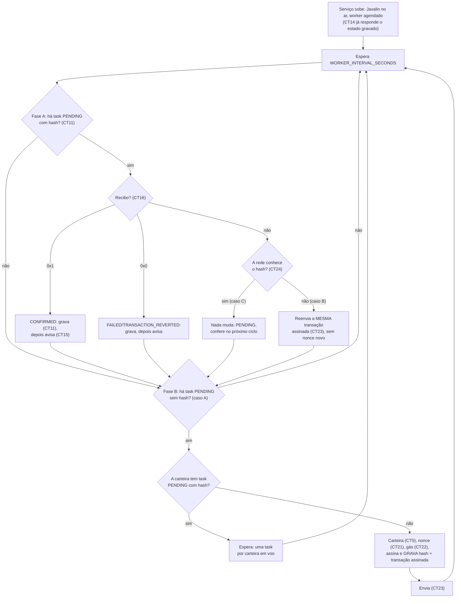

# Fluxo do E9 reescrito: retomada após reinício (Container 3)

Documento do H09.1 (OP#888), em 15/11/2026. Descreve como o Blockchain Service retoma as tasks depois de um reinício, do jeito que o código faz hoje (main desde o H08.1; o H09.1 não mudou código de produção).

**Este documento não emenda a Especificação.** O fluxo do E9 em `especificacao-entrega2.md` continua como está; as divergências abaixo vão ao relatório final. Fonte do desenho: `desenho-blockchain-service.md` (seções 7.3 e 7.5, decisões 8 e 9 da seção 12).

**Feito quando (da Entrega 1, sem mudança):** após um reinício do Container 3, uma task registrada antes do reinício continua consultável com o último estado conhecido, sem ficar "órfã".

## Divergências em relação ao E9 da Especificação

| Especificação | O que acontece de fato | Por quê |
|---|---|---|
| Passo 3: "ao subir, lê as tasks PENDING" | Não há rotina de partida. Quem retoma é o primeiro ciclo do worker, que é o mesmo ciclo de sempre. O `Main` sobe o Javalin e agenda o worker com `scheduleWithFixedDelay(ciclo, WORKER_INTERVAL_SECONDS, WORKER_INTERVAL_SECONDS)`: o primeiro ciclo roda **WORKER_INTERVAL_SECONDS depois da subida** (5 s no `.env.example`). Nesse intervalo o CT14 já responde, com o estado gravado | O banco é a fila (seção 7.1 do desenho): o ciclo não distingue "primeira vez" de "depois do reinício" |
| Passo 3: só consulta o recibo (CT16) | Tasks com hash: recibo (CT16) e, sem recibo, a consulta por hash (CT24), com reenvio da mesma transação assinada (CT23). Tasks sem hash: são assinadas e enviadas (CT5, CT21, CT22, CT23), como qualquer task nova | A Especificação só cobre a task já enviada; o reinício pode cair antes ou durante o envio |
| Passo 6: notifica o Core API (CT15) | Notifica, mas sem retentativa: se a queda cair entre gravar o estado final e avisar, o aviso se perde, e o Core API recupera pelo CT14 (E5, passo 9) | P4 em aberto (decisão 8, limitação 4) |

## Os três casos de retomada

O estado vem todo da tabela `task` (CT11). "Primeiro ciclo" é o primeiro ciclo do worker depois da subida.

| Caso | Quando a queda aconteceu | Estado no banco | O que o primeiro ciclo faz | Contratos |
|---|---|---|---|---|
| **A. Nunca enviada** | Antes de assinar, ou antes de gravar o hash | `PENDING`, `transaction_hash` e `signed_transaction` vazios | Fase B: lê a carteira, pede nonce e gás de novo, assina, **grava hash e transação assinada**, envia. Fica `PENDING` com hash | CT11, CT5, CT21, CT22, CT23 |
| **B. Assinada e gravada, envio incerto** | Entre gravar o hash e enviar, ou no envio sem resposta | `PENDING`, hash e transação assinada preenchidos; a rede não conhece o hash | Fase A: sem recibo (CT16), a rede não conhece (CT24): **reenvia a mesma transação assinada** (CT23), sem pedir nonce novo. Fica `PENDING` | CT11, CT16, CT24, CT23 |
| **C. Enviada** | Depois do envio, antes do recibo | `PENDING` com hash; a rede conhece o hash | Fase A: sem recibo (CT16), a rede conhece (CT24): não faz nada e confere de novo no ciclo seguinte. Com recibo: `CONFIRMED` (0x1) ou `FAILED`/`TRANSACTION_REVERTED` (0x0), grava e avisa | CT11, CT16, CT24, CT15 |

Em qualquer dos casos, o CT14 responde o último estado gravado desde a subida, sem chamar o RPC (o `TaskService` nem recebe o `EthereumClient`).

## Passos do E9 reescritos

1. Pré-condição: o Usuário iniciante enviou uma transação (fluxo E4). A task está gravada no Banco do Blockchain Service (CT11 `task`) como `PENDING`, com ou sem hash, e o Core API tem a transação `PENDING` (CT12 `eth_transaction`).
2. O Blockchain Service (Container 3) cai ou é reiniciado. Todo o estado das tasks está no banco; o worker não guarda nada entre ciclos.
3. O serviço sobe: Javalin no ar e worker agendado. O CT14 já responde. Não há leitura especial de partida.
4. WORKER_INTERVAL_SECONDS depois da subida, roda o primeiro ciclo, igual a qualquer outro:
   - Fase A, tasks `PENDING` com hash (casos B e C): recibo (CT16); sem recibo, consulta por hash (CT24); se a rede não conhece, reenvia a mesma transação assinada (CT23).
   - Fase B, tasks `PENDING` sem hash (caso A), só de carteiras sem task em voo: carteira (CT5), nonce (CT21), gás (CT22), assina, **grava hash e transação assinada**, envia (CT23).
5. Enquanto isso, o Frontend faz polling (CT13), o Core API consulta o CT14 e recebe o último estado gravado (`PENDING`, com o hash se ele já foi gravado). A task não ficou órfã.
6. Quando o recibo aparece, o worker grava `CONFIRMED` (ou `FAILED`) na task (CT11) e só depois avisa o Core API (CT15). Se o aviso falhar ou se perder, o Core API recupera pelo CT14 (E5, passo 9).
7. No polling seguinte, o Frontend recebe o estado final (CT13).

**Regra que sustenta o fluxo: o hash nunca fica sem gravar.** Hash e transação assinada são gravados **antes** do envio. Isso responde à pergunta da H01.1 ("como o serviço descobre, pela rede, que uma task sem hash já foi enviada?"): a pergunta deixa de existir. Ou a task tem hash, e a rede é consultada por ele (CT24); ou nunca foi assinada, e nada foi enviado.

## Por que não há envio duplicado

- **Uma única instância** do serviço contra o banco, portanto um único worker (uma thread, um ciclo de cada vez).
- **No máximo uma task por carteira em voo:** a Fase B pula a carteira que tem task `PENDING` com hash. Depois do reinício, a segunda task da carteira só sai quando a primeira fica final.
- **O reenvio usa a mesma transação assinada:** mesmo hash, mesmo nonce. Se a original e o reenvio chegarem à rede, são uma só transação.
- **Queda antes de gravar o hash não enviou nada:** o envio só acontece depois da gravação. O próximo ciclo pede o nonce de novo e assina outra vez; como nada foi à rede, o nonce é o mesmo e não há duas transações.

## Diagrama

## Limitações

1. **Aviso perdido.** Se a queda cair entre gravar o estado final e enviar o webhook, o aviso não sai, e o worker novo não avisa de novo (a task já é final e não é acompanhada). O Core API recupera pelo CT14 (E5, passo 9). Sem retentativa enquanto a P4 estiver em aberto.
2. **Task presa em `PENDING`.** Não há tempo limite de task (item 1 de "Em aberto" no desenho). Uma transação descartada pela rede cujo reenvio responde "nonce too low" fica `PENDING` para sempre.
3. **Instância única.** Uma segunda instância contra o mesmo banco seria um segundo worker e poderia assinar a mesma task duas vezes. O compose de desenvolvimento sobe uma só.
4. **`docker compose restart` é parada graciosa.** O `Main` para o Javalin e espera até 30 s o ciclo terminar antes de fechar o banco. A queda abrupta no meio do ciclo está coberta pelos testes (`SimulatedCrash`) e pela rodada com `docker compose kill` abaixo.

## Verificação

### Testes (sem banco e sem rede)

`TaskWorkerRestartTest`: "reinício" é um `TaskWorker` novo sobre o mesmo repositório em memória; a queda é um `SimulatedCrash` (estende `Error`, atravessa os `catch` do worker e sai de `runCycle`).

| Caso | Teste |
|---|---|
| A (queda antes de assinar) | `taskNeverSentIsSignedAndSentOnceAfterRestart` |
| B (queda no envio, rede não conhece) | `crashWhileSendingResendsTheSameSignedTransactionAfterRestart` |
| C, recibo 0x1 | `sentTransactionIsNotResentAndConfirmsAfterRestart` |
| C, recibo 0x0 | `sentTransactionRevertedAfterRestartFailsKeepingHash` |
| Mesma carteira, C + A | `secondTaskOfTheSameWalletWaitsForTheFirstAfterRestart` |
| Aviso perdido (limitação 1) | `lostNotificationIsNotResentAfterRestart` |
| Passo 5 (CT14 depois do reinício, sem RPC) | `getTaskAfterRestartAnswersTheLastStoredStateWithoutTheRpc` |

### Roteiro real na Sepolia (15/11/2026)

`scripts/send-demo.sh` com `RESTART_AFTER`, origem `0xbdd26d8f9b9876d59cd6ebe1f25a1286b8ecacd5` (carteira de demonstração), destino `0x499956bc81fbe5267b7841f14dd9668dc88c4088` (conta já existente), 0.0005 ETH por rodada. Saldo do destino e nonce da origem medidos no PublicNode antes e depois de cada rodada.

| Rodada | Estado antes do reinício | De volta em | Primeiro ciclo depois da volta | Final | Destino (ETH) | Nonce | Transação |
|---|---|---|---|---|---|---|---|
| `RESTART_AFTER=accepted` | `PENDING` sem hash (caso A) | 5 s | assinou, gravou e enviou | `CONFIRMED`, bloco 12142400, gás 21.000 | 0.0015 → 0.0020 | 3 → 4 | [0x7bb3…1da1](https://sepolia.etherscan.io/tx/0x7bb3802e8474eaf118a6dcacdc5e6274ea36d6e69164de7dc16fc9fcb1db1da1) |
| `RESTART_AFTER=sent` | `PENDING` com hash (caso C) | 5 s | recibo já presente: `CONFIRMED` | `CONFIRMED`, bloco 12142402, gás 21.000 | 0.0020 → 0.0025 | 4 → 5 | [0x2d14…dab7](https://sepolia.etherscan.io/tx/0x2d147207b0ee1db84d96fc9ce10110b83dad48d3ca944c0f534290fd888ddab7) |
| Extra: `docker compose kill` + `up -d` depois do hash | `PENDING` com hash (caso C) | ~3 s | recibo já presente: `CONFIRMED` | `CONFIRMED`, bloco 12142405, gás 21.000 | 0.0025 → 0.0030 | 5 → 6 | [0x51d3…6cbc](https://sepolia.etherscan.io/tx/0x51d31913863f82d516f3f2d571d8e782536fcebcdb71a514de5b8a90317c6cbc) |

Cada rodada gerou uma única transação: o destino subiu exatamente 0.0005 e o nonce da origem avançou 1. Em todas, o primeiro ciclo rodou cerca de 5 s depois da linha "Blockchain Service no ar" do log. O webhook falhou com `ConnectException` (o host da Core API não existe no desenvolvimento), como esperado. No real, o caso B não aparece (o envio acontece milissegundos depois da gravação); ele está coberto pelo teste.
